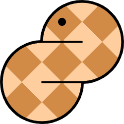
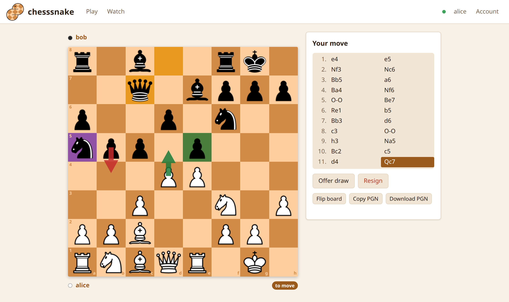
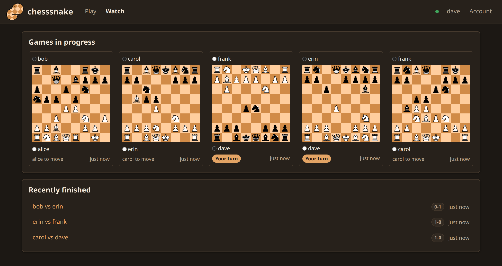
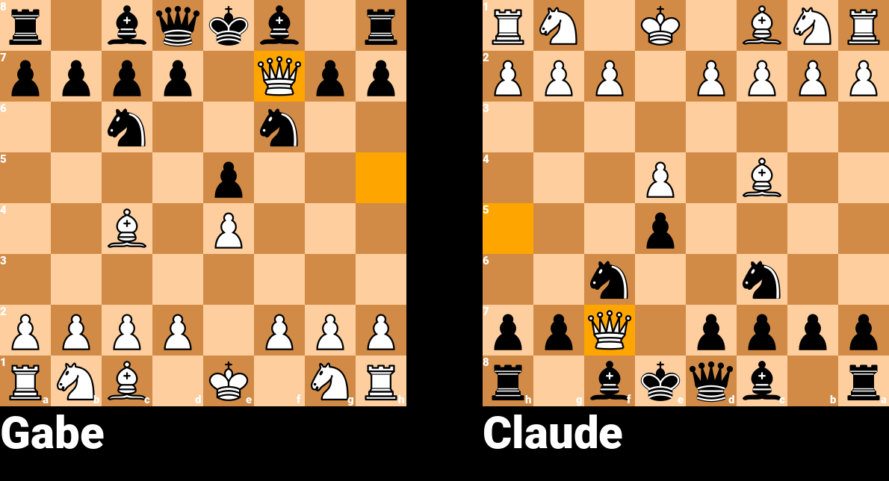

<div align="center">



# chesssnake

**Play, render and persist chess games in Python: from a library, a REST API, or your terminal.**

[](https://pypi.org/project/chesssnake/)
[](https://pypi.org/project/chesssnake/)
[](https://github.com/GabeBecker2048/chesssnake/pkgs/container/chesssnake)
[](https://github.com/GabeBecker2048/chesssnake/blob/main/LICENSE)
[](https://github.com/GabeBecker2048/chesssnake/actions/workflows/ci.yml)

</div>

<p align="center">
  <a href="https://raw.githubusercontent.com/GabeBecker2048/chesssnake/main/docs/web-ui.png"></a>
  <a href="https://raw.githubusercontent.com/GabeBecker2048/chesssnake/main/docs/web-ui-watch.png"></a>
</p>

<sub>The web UI that comes with the server: a game in progress with board marks, and the Watch page, where every game in progress updates live (dark theme).</sub>

**A chess engine, a board renderer and a game server in one package.** Play in
Python, draw the position as a PNG, and keep games in SQLite or PostgreSQL
through a REST api-endpoint that many clients can share.

- Full rules: castling, en passant, promotion, checkmate, stalemate, and draws
  by threefold repetition, the fifty-move rule and insufficient material.
- Board images from any position, one side or both, last move highlighted.
  Returns a PIL image, so you can keep editing it.
- Standard formats in and out: FEN, PGN, SAN, legal-move listing.
- **The server owns the rules**, so a client cannot cheat and a frontend in any
  language needs no chess logic of its own.
- **Live updates** (opt-in): clients can follow games over a websocket and see
  each move the moment it is made, instead of polling.
- **A web UI** served by the api-endpoint: play in the browser, watch any game,
  and manage accounts from an admin panel.
- Pure Python. Pillow is the only dependency for a local game.

Pronounced "chess-snake", after Python being a kind of snake. Not cheesecake.

> **Alpha.** Minor versions regularly contain breaking changes. Not recommended
> for production until 1.0.0.

## Four ways to use it

| | How | Needs |
|---|---|---|
| **Library** | `Game.local(...)` runs the engine in your process | `pip install chesssnake` |
| **Client + server** | `Game.remote(...)` talks to an api-endpoint, or call the REST routes from any language | `chesssnake[client]`, and a server |
| **Terminal** | `chesssnake play` | nothing extra |
| **Browser** | open the api-endpoint's address | a server |

All four share the same rules and the same routes, so a game started in the
CLI can be continued over REST, and the other way round.

## Install

chesssnake runs as a Python package, or as a Docker container for the server.

### Python

```sh
pip install chesssnake                  # local games and rendering
pip install chesssnake[client]          # also play on a remote api-endpoint
pip install chesssnake[api]             # also run the server (SQLite: no database server needed)
pip install chesssnake[api,postgres]    # ... with PostgreSQL
```

Requires Python 3.12 or newer.

```python
from chesssnake import Game

game = Game.local(white_name="Bob", black_name="Alice")
game.move("e4")
game.move("e5")
game.save("board.png")        # a PNG of the position
print(game.fen)               # rnbqkbnr/pppp1ppp/8/4p3/4P3/8/PPPP1PPP/RNBQKBNR w KQkq e6 0 2
```



<sub>Rendered by chesssnake itself: `game.save("board.png")` after `1. e4 e5 2. Qh5 Nc6 3. Bc4 Nf6 4. Qxf7#`. The last move is highlighted, and each player sees the board from their own side.</sub>

Or play it in the terminal, with no server:

```sh
chesssnake play --local
```

### Docker

Images are published to `ghcr.io/gabebecker2048/chesssnake` for amd64 and arm64.
Save this as `docker-compose.yml` in a new folder:

```yaml
services:
  chesssnake:
    image: ghcr.io/gabebecker2048/chesssnake:latest   # or :0.9 to stay on 0.9.x
    restart: unless-stopped
    user: "1000:1000"              # who owns ./data (`id -u`:`id -g`)
    ports:
      - "8000:8000"
    volumes:
      - ./data:/data
    environment:
      CHESSSNAKE__DATABASE__URL: sqlite:////data/chesssnake.db
      CHESSSNAKE__DATABASE__INIT_SCHEMA: "1"
      # Anyone may make an account only if you open registration:
      # CHESSSNAKE__API__REGISTRATION: "open"
      # Live updates: chesssnake play shows the opponent's move as it happens.
      # CHESSSNAKE__WEBSOCKET__ENABLED: "1"
    read_only: true
    tmpfs: [/tmp]
    cap_drop: [ALL]
    security_opt: ["no-new-privileges:true"]
    mem_limit: 512m
```

Then, in that folder:

```sh
mkdir data           # so it is yours, not root's
docker compose up -d
curl localhost:8000/health
docker compose exec chesssnake chesssnake user create alice --admin   # the first account
```

That is the whole server: SQLite in a file under `./data`, no database to
install. For PostgreSQL, hardening notes and what to do before exposing it, see
[the guide](docs/guide.md#deploying-with-docker).

### Connect to it

Players are accounts, and a game starts when one challenges another. The
simplest way in is a browser: open <http://localhost:8000/> and log in (that is the
web UI pictured at the top).

From a terminal, anywhere on the network:

```sh
chesssnake login --api-url http://localhost:8000     # once; the token is remembered
chesssnake challenge bob                              # bob runs: chesssnake accept ID
chesssnake play --vs bob
```

With live updates on (`CHESSSNAKE__WEBSOCKET__ENABLED`), each player's terminal
shows the other's move the moment it is made; without them it checks every 10
seconds.

From Python:

```python
from chesssnake import Game, connect

client = connect("http://localhost:8000", username="alice", password="...")
game = Game.remote(client.current_games()[0], client=client)
game.move("e4")
```

Or over plain HTTP, from any language:

```sh
TOKEN=$(curl -s localhost:8000/v1/auth/login -H 'Content-Type: application/json' \
  -d '{"username":"alice","password":"..."}' | jq -r .token)
curl -X POST localhost:8000/v1/games/1/moves -H "Authorization: Bearer $TOKEN" \
  -H 'Content-Type: application/json' -d '{"move":"e4"}'
```

## More

- [The guide](docs/guide.md): the Python API, running an api-endpoint, playing
  in a terminal, and deploying with Docker
- [REST API reference](docs/rest-api.md): every endpoint, every error code
- [The web UI](docs/web-ui.md): playing, watching and the admin panel in a browser
- [Real-time updates](docs/realtime-websockets.md): the websocket protocol, for
  frontends that want moves as they happen
- [Configuration](docs/configuration.md): every setting and its environment variable
- [CHANGELOG.md](CHANGELOG.md) and [ROADMAP.md](ROADMAP.md): what changed, and what is next
- [CLAUDE.md](CLAUDE.md): how the codebase fits together, useful to any contributor
- [Releasing](docs/releasing.md): how a version reaches PyPI and ghcr.io

## Contributing

Issues and pull requests are welcome. The project is managed with
[uv](https://docs.astral.sh/uv/):

```sh
uv sync --extra api --extra client --extra postgres   # the full stack
uv run pytest                                         # both backends
uv run ruff check && uv run ruff format --check && uv run mypy
```

CI runs the suite on Python 3.12 to 3.14, against both SQLite and PostgreSQL,
with a coverage gate.

## License

MIT, see [LICENSE](LICENSE).
