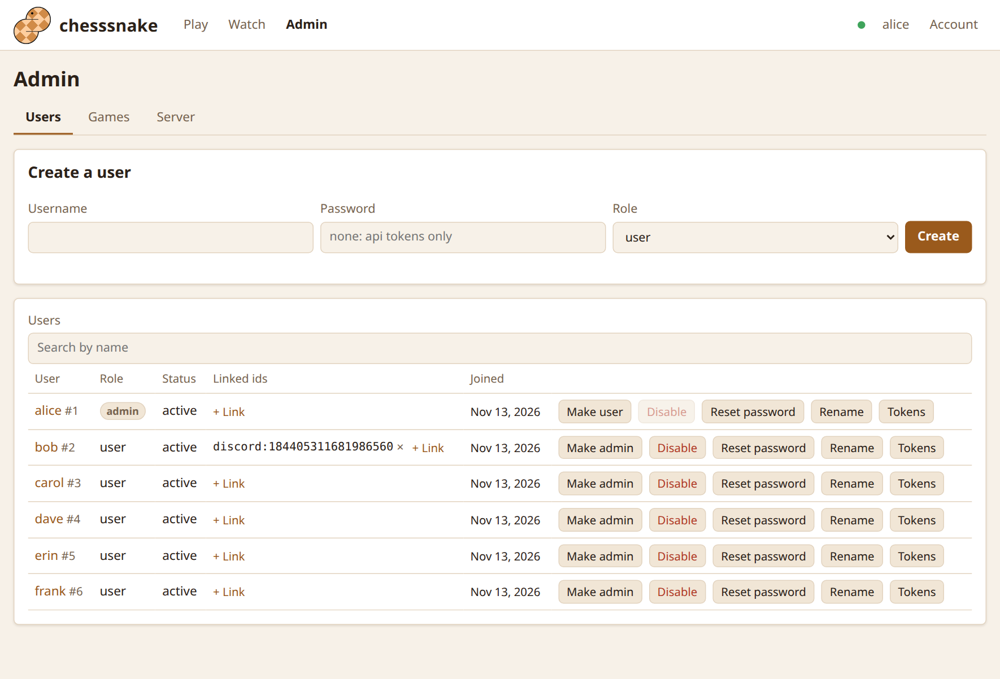

Every player is an account on your server, and everything needs a login.
Accounts are yours to hand out: nothing is shared with any other chess site.

## The first administrator

Make it on the server's own machine:

```sh
chesssnake user create yourname --admin
# in Docker:
docker compose exec chesssnake chesssnake user create yourname --admin
```

It asks for a password (8 to 256 characters). After that, everything else can
be done from the Admin page in the browser.

## Users and administrators

| | User | Administrator |
|---|---|---|
| Play, challenge, watch any game | yes | yes |
| Rename themselves, change their password, make api tokens | yes | yes |
| Create, rename, disable accounts and reset passwords | no | yes |
| Start a game between any two players, delete games | no | yes |
| Move, resign or challenge on a player's behalf | no | yes |
| Link an account to an outside id, such as Discord | no | yes |

The last enabled administrator cannot be demoted or disabled.

## The Admin page



- **Users:** create an account, search, make someone an admin or a user,
  disable or enable, reset a password, rename, see and revoke their logins and
  tokens, and link or unlink an outside id.
- **Games:** start a game between two players, and watch or delete any game.
- **Server:** the version, and which features are on.

Disabling an account or resetting its password logs it out everywhere at once.

## Letting people register

By default only administrators make accounts. To let anyone sign up from the
login page:

```toml
[api]
registration = "open"
```

or `CHESSSNAKE__API__REGISTRATION=open`. Usernames are 2 to 32 letters,
digits, `_`, `.` or `-`, and unique ignoring case.

## Logins and api tokens

- A **login** is what you get by logging in from a browser or `chesssnake login`.
  It lasts 30 days (`api.session_lifetime_days`).
- An **api token** is for a script or a bot. It has a name, and expires when
  you choose, or never. Make one on the Account page under **New api token**,
  or for any user from the server's machine:

  ```sh
  chesssnake user token alice --name my-script
  ```

A token is shown once, when it is made. Each can be revoked on its own from
the Account page.

| When this happens | Logins | Api tokens |
|---|---|---|
| You log out | that one ends | |
| You change your own password | all others end | kept |
| An administrator resets your password | all end | all end |
| An administrator disables you | all end | all end |

## Managing accounts from the command line

`chesssnake user` works straight on the database, so it needs no login and
works when the server is stopped. Run it where the server's database setting
is available (inside the container, with Docker).

```sh
chesssnake user create bob                 # asks for a password
chesssnake user create helper-bot --no-password   # api tokens only
chesssnake user show bob
chesssnake user set-role bob admin
chesssnake user rename bob robert
chesssnake user set-password bob           # also logs bob out everywhere
chesssnake user disable bob
chesssnake user enable bob
chesssnake user link bob discord 184405311681986560
chesssnake user token bob --name my-script --expires-days 90
```

> Locked out of the only admin account? `chesssnake user set-password yourname`
> on the server's machine sets a new password.
{: .tip }

A user is named by username or id. Passwords are never taken as arguments:
they are asked for, or read with `--password-stdin`.
