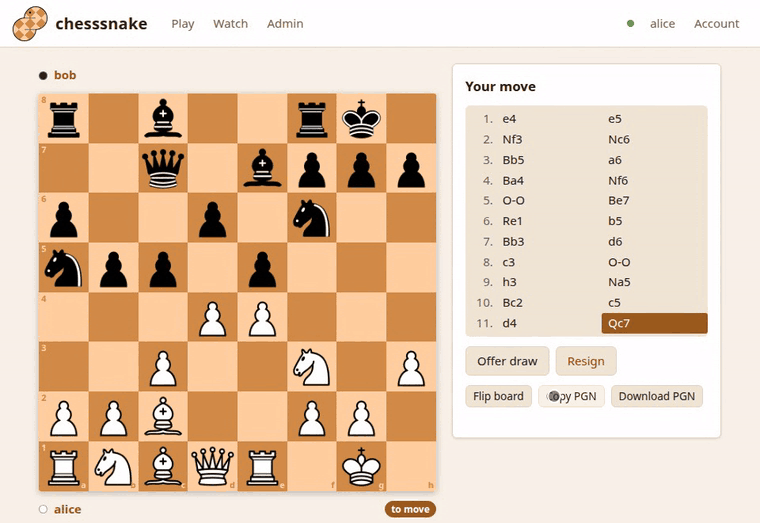
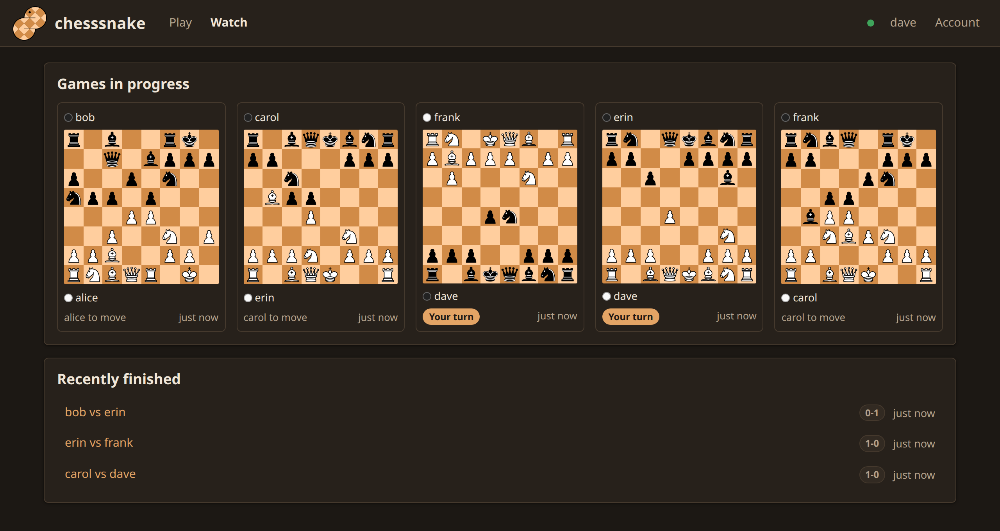
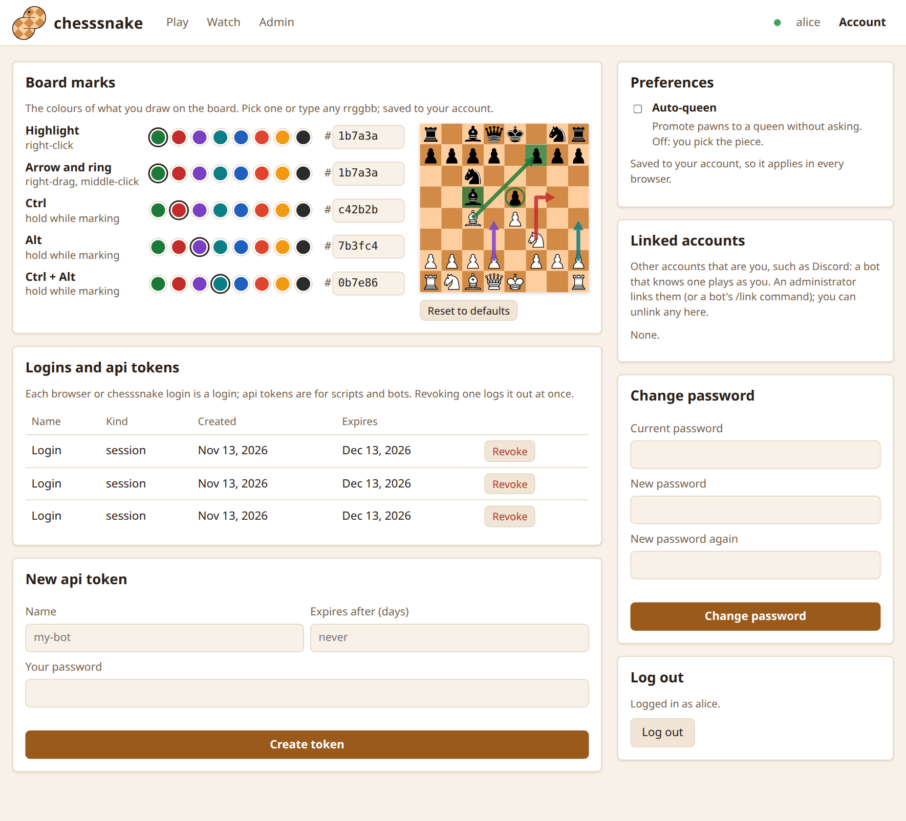

The server comes with a website: open its address, log in, and play. It is
deliberately simple. There is no chat, rating or clock.

## Logging in

Use the username and password of your account on that server. If the server
allows it, the login page also offers **Create an account**; otherwise an
administrator makes accounts (see [Accounts](accounts.html)).

## The pages

| Page | What is on it |
|---|---|
| **Play** | Your games in progress as small boards, the ones where it is your move first. Your pending challenges, and a form to challenge someone by name. |
| **Game** | The board, the moves so far, and the game buttons. |
| **Watch** | Every game in progress on the server, as live boards, and the latest results. Open one to follow it. |
| **Profile** | Click any player's name: their games, your record against them, and a button to challenge them. |
| **Account** | Your preferences, password, logins and api tokens. |
| **Admin** | Administrators only. See [Accounts](accounts.html#the-admin-page). |

The site follows your system's light or dark setting.

## Playing a game

- **Move** by clicking a piece and then a square, or by dragging. The squares
  the piece can go to are marked. Castle by moving the king two squares, or by
  dropping it on its rook.
- **Promotion** asks which piece you want, unless you turn on
  [auto-queen](#your-account).
- **Offer draw** on your own turn; your opponent gets **Accept draw** and
  **Decline draw**. **Resign** at any time.
- **Rematch**, once the game is over, challenges your opponent with the
  colours swapped. If they offered first, the button is **Accept rematch**.
- **Flip board**, **Copy PGN** and **Download PGN** are under the move list.

Anyone logged in can watch any game. A spectator sees the same page without
the game buttons.

## Marking the board

Draw on the board to think, as on other chess sites. Marks are yours alone:
nothing is sent to your opponent, and spectators can mark too.

| Do this | To get |
|---|---|
| Right-click a square | a highlighted square |
| Right-drag from one square to another | an arrow (a knight's move bends into an L) |
| Middle-click a square | a ring |
| Hold <kbd>Ctrl</kbd>, <kbd>Alt</kbd> or both while marking | a second, third or fourth colour |
| Make the same mark again | that mark removed |
| Left-click the board | every mark cleared |

Marks need a mouse, so they are not available on touch screens.

## Your account

- **Board marks:** the colour of each kind of mark. Pick a preset or type any
  `rrggbb`; the small board previews it.
- **Auto-queen:** promote pawns to a queen without asking. Off by default.
- **Linked accounts:** other accounts that are you, such as Discord, so a bot
  knows who you are. An administrator or the bot links them; you can unlink any.
- **Change password.** This logs out your other browsers and terminals, and
  keeps your api tokens.
- **Logins and api tokens:** every place you are logged in. **Revoke** logs one
  out at once.
- **New api token:** a token for a script or bot to act as you. It is shown
  once, so copy it then. See [Python client](python-client.html).

Preferences are saved to your account, so they follow you to every browser.

## The dot beside your name

| Dot | Meaning |
|---|---|
| Green | Live: boards update the moment a move is made. |
| Grey | The server has live updates turned off. The site still works: a game checks for moves every 5 seconds, lists every 15. |
| Amber | The live connection dropped. The site checks periodically until it is back. |

Live updates are on by default. Whoever runs the server can turn them off: see
[Live updates](live-updates.html).
