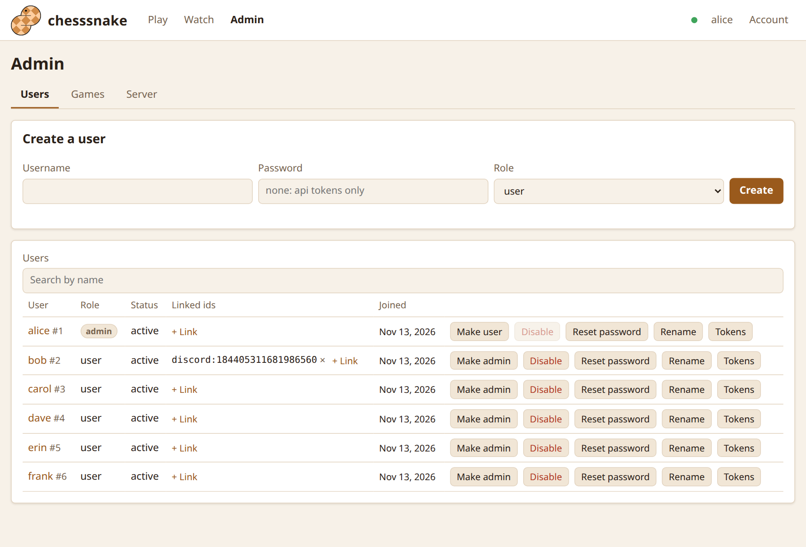
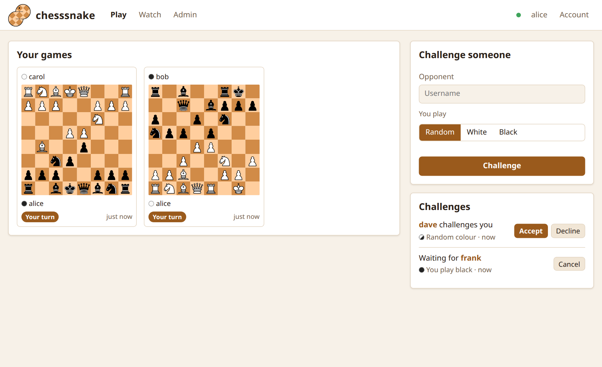
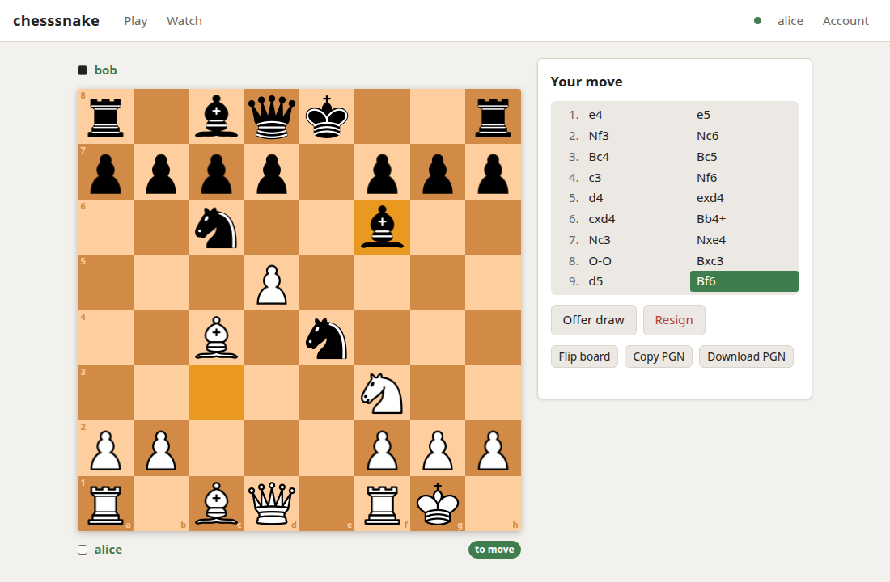

A walk through from an empty server to a finished game. It assumes the server
from [Install](install.html) is running at `http://localhost:8000` and you made
your admin account.

## 1. Make a second account

A game needs two players. Log in at `http://localhost:8000/`, open **Admin**,
and under **Create a user** make an account for your opponent (here, `bob`).



Or do it on the server's machine:

```sh
docker compose exec chesssnake chesssnake user create bob
```

To let people sign themselves up instead, see
[Accounts](accounts.html#letting-people-register).

## 2. Send a challenge

Games start with a challenge. On the **Play** page, type your opponent's name
under **Challenge someone**, pick a colour (or leave it random) and press
**Challenge**.



## 3. Accept it

Your opponent logs in (another browser, or a private window) and presses
**Accept** under **Challenges**. The game opens for them, and you get a
notice with a link to it.

## 4. Play

Click or drag a piece; the squares it can move to are marked. The other player
sees each move as it is made. **Offer draw** and **Resign** are beside the
board, and when the game is over **Rematch** sends a new challenge with the
colours swapped.



## The same thing in a terminal

Everything above also works without a browser, from any machine with
`pip install 'chesssnake[client]'`:

```sh
export CHESSSNAKE__CLIENT__API_URL=http://localhost:8000   # which server
chesssnake login                 # once; the login is remembered
chesssnake challenge bob
```

and for bob:

```sh
export CHESSSNAKE__CLIENT__API_URL=http://localhost:8000
chesssnake login
chesssnake challenges            # lists the challenge and its id
chesssnake accept 1
chesssnake play --vs yourname
```

See [In the terminal](terminal.html).

## Next

- [In the browser](browser.html): everything the web UI can do.
- [Accounts](accounts.html): roles, registration, api tokens.
- [Hosting publicly](hosting-publicly.html): before anyone outside your network uses it.
