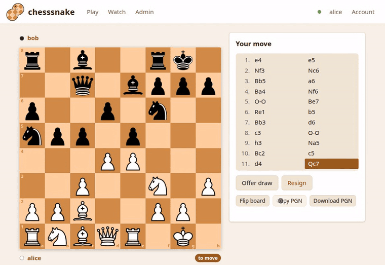

# A chess server you host yourself
{: .home-title }

chesssnake is a self-hosted chess server for bots and small communities, and a
Python chess library. Rules, board images, accounts, a REST API, live updates
and a web UI come in one container or one `pip install`, with no third-party
chess accounts needed.
{: .lead }

## Start here

  <a href="install.html"><b>1. Install</b>A server in Docker, or the Python package.</a>
  <a href="first-game.html"><b>2. Your first game</b>Make two accounts, send a challenge, play.</a>
  <a href="browser.html"><b>Play in the browser</b>The web UI that comes with the server.</a>
  <a href="python.html"><b>Use it from Python</b>Play, render and export games in your own code.</a>

## Four ways to use it

| | How | Needs |
|---|---|---|
| **Browser** | Open the server's address and log in. See [In the browser](browser.html). | a server |
| **Terminal** | `chesssnake play`. See [In the terminal](terminal.html). | nothing for an offline game; a server to play others |
| **Python** | `Game.local(...)` in your own process, or `Game.remote(...)` on a server. See [Python library](python.html). | `pip install chesssnake` |
| **REST** | Plain HTTP from any language. See [REST API](rest-api.html). | a server |

All four share the same rules and the same games, so a game started in the
terminal can be continued in the browser, or by a bot.

## What it does

- **Full rules:** castling, en passant, promotion, checkmate, stalemate, and
  draws by threefold repetition, the fifty-move rule and insufficient material.
- **The server owns the rules,** so a client cannot cheat and a frontend in any
  language needs no chess logic of its own.
- **Board images** of any position, from one side or both, with the last move
  highlighted.
- **Standard formats** in and out: FEN, PGN, SAN and UCI moves.
- **Live updates:** every board shows a move the moment it is made.
- **Accounts** with passwords and api tokens, and an admin panel to manage them.
- **SQLite or PostgreSQL.** SQLite needs no database server at all.

Pronounced "chess-snake", after Python being a kind of snake. Not cheesecake.

> chesssnake is in alpha. Until 1.0.0 a new version may change settings or need
> the database recreated; the [changelog](https://github.com/GabeBecker2048/chesssnake/blob/main/CHANGELOG.md)
> says when. See [Upgrading and backups](upgrading.html).
{: .warn }

## Getting help

- Something not working? See [Troubleshooting](troubleshooting.html).
- Found a bug or have an idea? [Open an issue](https://github.com/GabeBecker2048/chesssnake/issues).
