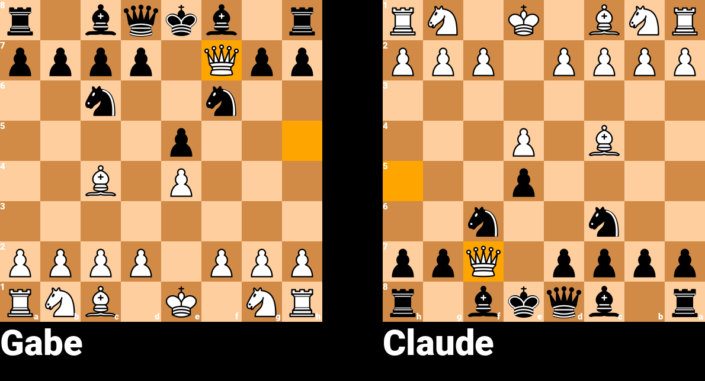

`pip install chesssnake` gives you a chess game you can play, draw and export
from your own code, with no server and no dependency but Pillow.

```python
from chesssnake import Game

game = Game.local(white_name="Bob", black_name="Alice")
game.move("e4")
game.move("e5")
game.save("board.png")        # a PNG of the position
print(game.fen)               # rnbqkbnr/pppp1ppp/8/4p3/4P3/8/PPPP1PPP/RNBQKBNR w KQkq e6 0 2
```

To play games kept on a server instead, see [Python client](python-client.html).
Everything on this page works the same on those games.

## Moves

`move()` takes SAN or UCI (see [Writing moves](moves.html)) and returns a
`MoveResult`:

```python
result = game.move("Nf3")
result.san            # "Nf3"
result.from_square    # "g1"
result.to_square      # "f3"
result.check          # True if it gives check
result.castle         # "K", "Q" or None
result.promotion      # "Q", "R", "B", "N" or None
result.en_passant     # True for an en-passant capture
result.legal_moves    # the other side's legal moves now
```

An illegal move raises an error that says why, and changes nothing:

```python
from chesssnake.engine.errors import ChessError, MoveIntoCheckError

try:
    game.move("Ke2")
except MoveIntoCheckError:
    ...
except ChessError as e:       # every chess error
    print(e)
```

The error classes are listed in [Writing moves](moves.html#when-a-move-is-refused).

`game.legal_moves()` lists every legal move as
`{"from": "g1", "to": "f3", "san": "Nf3", "promotion": None}`.

## The state of the game

```python
game.to_move          # Color.WHITE or Color.BLACK
game.is_over          # True once the game has ended
game.result           # GameStatus.IN_PLAY, WHITE_WON, BLACK_WON or DRAW
game.winner           # the winning Color, or None
game.termination      # why it ended: Termination.CHECKMATE, RESIGNATION, STALEMATE, ...
game.draw_offered_by  # the Color with an open draw offer, or None
game.move_history     # ["e4", "e5", "Nf3"]
```

`Color`, `GameStatus`, `PieceType` and `Termination` are importable from
`chesssnake`. Draws by rule end the game on their own: see
[How games end](moves.html#how-games-end).

## Resigning and draws

In a local game, white is player `0` and black is player `1`:

```python
game.offer_draw(0)     # white offers, on white's turn
game.accept_draw(1)    # or game.decline_draw(1)
game.resign(1)         # black resigns; white wins
```

## Board images



```python
game.save("board.png")                       # both sides, with the names (above)
game.save("white.png", perspective="white")  # one board, from white's side
image = game.render()                        # a PIL image, to edit or send
```

The last move is highlighted. For a board as text, `print(game)`.

## FEN and PGN

```python
game.fen                                  # the position as FEN
print(game.pgn())                         # the whole game as PGN

game = Game.from_fen("r1bqkbnr/pppp1ppp/2n5/4p2Q/2B1P3/8/PPPP1PPP/RNB1K1NR w KQkq - 2 3")
```

The parts of the FEN are also properties: `game.castling_rights`,
`game.en_passant`, `game.halfmove_clock`, `game.fullmove_number`.

## Just a position: `Board`

`game.board`, or a `Board` on its own, is a position with no players attached:

```python
from chesssnake.engine import Board, Color, PieceType

board = Board()                              # the start, or Board.from_fen(...)
board.piece_at("e1")                         # Piece(type=PieceType.KING, color=Color.WHITE)
board.pieces(PieceType.KNIGHT, Color.WHITE)  # ["b1", "g1"]
board.is_attacked("f3", by=Color.WHITE)      # True
board.is_check()                             # is the side to move in check?
board.legal_moves()
move = board.move("e4")                      # a Move: from_square, to_square, piece, san, ...
board.undo()                                 # take it back
board.fen
```

Also `is_checkmate()`, `is_stalemate()`, `is_insufficient_material()` and
`copy()`.

> The names in `chesssnake.__all__` and `chesssnake.engine.__all__` are the
> public API. Anything else, including every name starting with `_`, may change
> without notice.
{: .tip }
