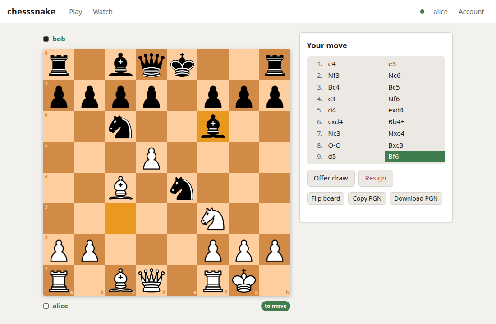

# The web UI

Since 0.14.0 the api-endpoint serves a website at `/`: open the server's address
in a browser, log in, and play. It is deliberately simple. Each page does one
thing, and there is no chat, rating or clock.



- [What it does](#what-it-does)
- [Turning it on and off](#turning-it-on-and-off)
- [Live updates](#live-updates)
- [Security](#security)
- [Running it behind a proxy](#running-it-behind-a-proxy)
- [How it is built](#how-it-is-built)

---

## What it does

Every page needs a login, the same accounts the API and `chesssnake play` use. If
the server has `api.registration = "open"`, the login page also offers to create
an account; otherwise an administrator makes them.

| Page | What is on it |
|---|---|
| **Play** (`#/`) | Your games in progress as small boards, games where it is your move first. Your pending challenges (accept, decline, withdraw), and a form to challenge someone by name, choosing white, black or random. |
| **Game** (`#/game/41`) | The board, the moves so far, and what you may do: move by **clicking or dragging** a piece (the legal squares are marked), offer, accept or decline a draw, resign, and afterwards **rematch** with colours swapped. Flip the board, or copy or download the PGN. |
| **Watch** (`#/watch`) | **Every game in progress**, from anyone, as a grid of live boards, and the latest results. Open one to follow it move by move. |
| **Profile** (`#/user/bob`) | A player's games in progress and finished, your record against them, and a button to challenge them. |
| **Account** | Change your password; see your logins and api tokens and revoke any of them; make an api token for a script or bot (shown once). |
| **Admin** | For administrators only. **Users**: search, create, promote or demote, disable or enable, reset a password, rename, see and revoke their tokens. **Games**: start a game between two players, watch or delete any game. **Server**: the version and which features are on. |

A spectator sees the same game page as the players, without the buttons. Any
logged-in user may watch any game, as any user may read any game over REST.

Games started elsewhere (a Discord bot's, in another `group_id`) show up and
can be played and watched like any other. Challenges made from the site are in
group 0, and a rematch stays in its game's group.

The board uses the same piece images as the PNGs the API renders. Moves are
shown in the notation the API speaks, with castling written `O-O`.

---

## Turning it on and off

It is **on by default**. To serve only the API (for a server that only bots use):

```toml
[web]
enabled = false
```

or `CHESSSNAKE__WEB__ENABLED=0`. Off, `/` and `/assets/...` answer 404 and
nothing else changes. See [configuration](configuration.md#web-ui).

---

## Live updates

With [`[websocket]`](configuration.md#websocket) enabled, the site keeps one
websocket open and every board on screen updates the moment a move is saved.
Locally a move reaches the other player's screen in about 25 to 70 ms. The dot
next to your name in the top bar is green while it is connected.

Without websockets the site still works fully: a game page checks for changes
every 5 seconds, and the lists every 15. The dot is grey, and hovering over it
says so. If the socket drops (a server restart), the site polls until it
reconnects, then picks up where it was.

The Watch page re-reads its list of games every 15 seconds even when live,
because a spectator is not told when a game between other people starts.

---

## Security

- **Logins.** The site logs in with `POST /v1/auth/login` and keeps the session
  token in the browser's `localStorage`, sending it as `Authorization: Bearer`
  like any other client. Logging out revokes it on the server. A session lasts
  `api.session_lifetime_days`; an expired, revoked or disabled login sends the
  site back to the login page.
- **Content Security Policy.** Every page and file is served with a strict CSP:
  scripts, styles and connections only from the site itself, no inline script, no
  `eval`, and no framing. The site loads nothing from anywhere else (no fonts, no
  CDN, no analytics), and puts text on the page only as text, never as HTML. This
  is what keeps a token in `localStorage` out of reach of injected script.
- **HTTPS.** Passwords and tokens cross the network, so put the server behind
  HTTPS when it is reachable from anywhere you do not trust; see
  [Exposing it](guide.md#exposing-it).
- The pages are static and public (they hold no data); everything they show comes
  from `/v1` with your token, under the same rules as any other client.

---

## Running it behind a proxy

Proxy the whole site, `/`, `/assets/` and `/v1/`, to the api-endpoint. Nothing
needs rewriting. For live updates the proxy must also pass the websocket upgrade
on `/v1/ws`: Caddy's `reverse_proxy` does without configuration, and nginx needs
the `Upgrade` headers described in
[Running it](realtime-websockets.md#running-it).

The site is served from the same origin as the API and the websocket, so the
default `websocket.allowed_origins = ["*"]` works. If you restrict it, include
the address people open the site at, e.g. `["https://chess.example"]`.

Files are sent with `Cache-Control: no-cache` and an ETag, so after an upgrade
browsers fetch the new version at once, and otherwise get a `304`.

---

## How it is built

Plain HTML, CSS and JavaScript modules in `src/chesssnake/data/web/`, shipped in
the wheel as package data and served by `chesssnake.api.web`. There is no
framework and no build step, so nothing but Python is needed to develop or
release it. The whole site is about 100 KB before compression, plus the piece
images.

The site is a client of the public API and nothing more: it uses the same
routes as any other client, four of which were added for it (`GET /v1/info`,
`GET /v1/games/live`, `GET /v1/games/finished` and `GET /v1/users/search`). It never decides what is legal. Its board offers the
moves `GET /v1/games/{id}/legal-moves` lists and sends the one you pick, so the
server's rules are the only rules, as with `chesssnake play`.
